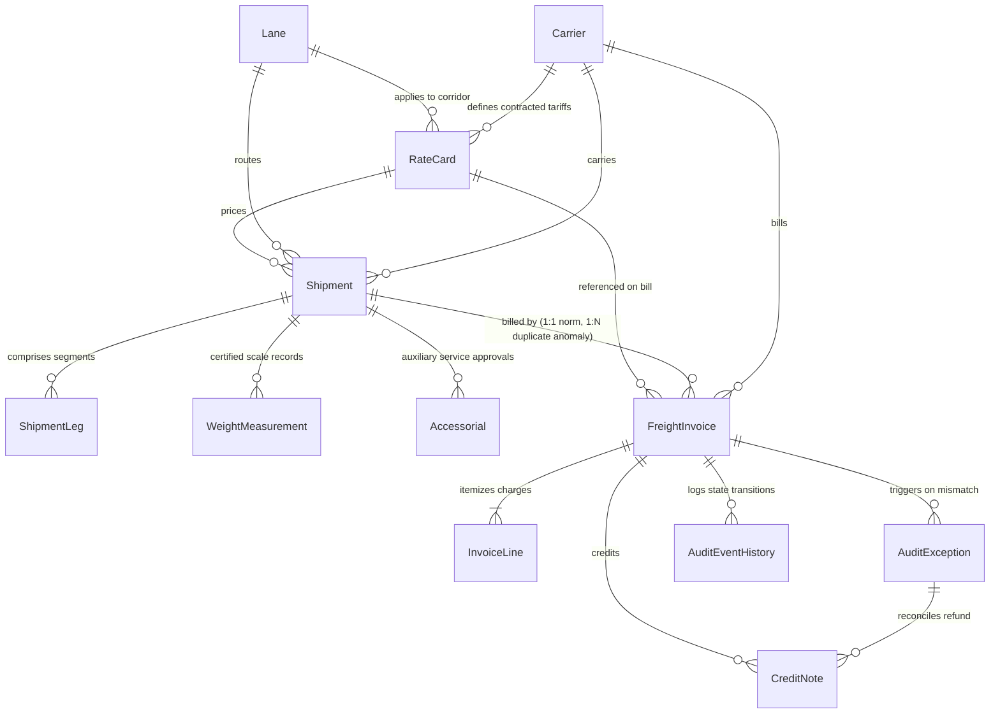

# Architecture & System Design — Freight Invoice Validation & Audit

## 1. System Overview

The **YotaFlex Freight Invoice Validation & Audit System** provides an end-to-end automated platform for validating carrier freight billing against contracted tariffs, physical shipment characteristics, auxiliary service (accessorial) approvals, and delivery records.

It exposes explainable decisions (`PASS`, `REVIEW`, `REJECT`), maintains an immutable chronological audit trail (`audit_event_history.csv`), isolates synthetic ground truth evaluation data, and provides both programmatic APIs and an interactive visual workbench.

```
                           +----------------------------+
                           |  Master Contract Tariffs   |
                           |   (RateCard / Carrier /    |
                           |          Lane)             |
                           +-------------+--------------+
                                         |
                                         v
+--------------------------+    +--------+---------+    +--------------------------+
|  Operational Shipments   | -> |  Audit Engine    | <- |     Freight Invoices     |
| (Actual Weight, Dim Wt,  |    |  3-Way Matching  |    | (Billed Base, Surcharge, |
|  Accessorials, POD Leg)  |    +--------+---------+    |   Accessorial Line Items)|
+--------------------------+             |              +--------------------------+
                                         v
                         +---------------+---------------+
                         |                               |
                         v                               v
            +------------------------+      +------------------------+
            |  Audit Decisions & KPIs|      | Exceptions & Disputes  |
            | (PASS, REVIEW, REJECT, |      | (Line-level variances, |
            |    Discrepancy ROI)    |      |  Credit note audits)   |
            +------------------------+      +------------------------+
```

---

## 2. Primary Actors & System Roles

| Actor / System | Responsibilities in Workflow | Key System Interactions |
|---|---|---|
| **Carrier / Warehouse Operator** | Enters certified scale weights, physical package dimensions ($L \times W \times H$), tenders shipment legs, captures Proof of Delivery (POD) signatories, submits freight invoices and issues credit notes. | Interacts via `shipment.csv`, `weight_measurement.csv`, `shipment_leg.csv`, `freight_invoice.csv`, `credit_note.csv`. |
| **Logistics Planner** | Defines lanes, schedules transit service levels (`STANDARD` vs `EXPRESS`), authorizes special handling (e.g. `LIFTGATE`, `HAZMAT`, `APPOINTMENT_DELIVERY`). | Pre-authorizes accessorial eligibility in `accessorial.csv`. |
| **Carrier Tariff Manager (Supplier)** | Negotiates contracted tariffs, weight tiers, base rates, and fuel surcharge indexes with shippers. | Maintains contractual rate card tariffs in `rate_card.csv`. |
| **Logistics Analyst** | Reviews automated audit exceptions, performs line-item variance root cause analysis, communicates formal disputes to carriers, and requests credit notes. | Uses the interactive Audit Workbench, inspects 3-way match drawer, triggers `/api/action` disputes. |
| **Operations Manager** | Monitors executive KPIs (discrepancy savings ROI, carrier accuracy scorecards, pass/review/reject ratios), and authorizes batch settlement payouts. | Signs off approved invoices and tracks financial recovery. |

---

## 3. Core Relational Entities & Cardinality

The system defines 11 core entities, an audit event log, and an evaluation ground truth table:



### Cardinality & Foreign Key Mapping

1. **Carrier (1 : N) RateCard**: Each carrier has contracted rate cards across multiple lanes, service tiers, and weight brackets.
   - FK: `rate_card.carrier_id -> carrier.carrier_id`
2. **Lane (1 : N) RateCard**: Multiple carriers quote rates for a commercial lane.
   - FK: `rate_card.lane_id -> lane.lane_id`
3. **Carrier (1 : N) Shipment & Lane (1 : N) Shipment**:
   - FK: `shipment.carrier_id -> carrier.carrier_id`
   - FK: `shipment.lane_id -> lane.lane_id`
   - FK: `shipment.rate_id -> rate_card.rate_id`
4. **Shipment (1 : N) ShipmentLeg**: Single-leg and multi-hub transit journeys.
   - FK: `shipment_leg.shipment_id -> shipment.shipment_id`
5. **Shipment (1 : N) WeightMeasurement**: Origin terminal scale weigh-ins.
   - FK: `weight_measurement.shipment_id -> shipment.shipment_id`
6. **Shipment (1 : N) Accessorial**: Pre-authorized accessorial charges (e.g. liftgate, detention).
   - FK: `accessorial.shipment_id -> shipment.shipment_id`
7. **FreightInvoice (1 : N) InvoiceLine**: Itemized billing breakdown (`BASE`, `FUEL`, accessorials).
   - FK: `invoice_line.invoice_id -> freight_invoice.invoice_id`
8. **FreightInvoice (1 : N) AuditException**: Discrepancies logged during 3-way matching.
   - FK: `audit_exception.invoice_id -> freight_invoice.invoice_id`
   - FK: `audit_exception.carrier_id -> carrier.carrier_id`
9. **AuditException (0..1 : N) CreditNote**: Credit memos issued by carriers to rectify approved dispute variances.
   - FK: `credit_note.exception_id -> audit_exception.exception_id`
   - FK: `credit_note.invoice_id -> freight_invoice.invoice_id`
   - FK: `credit_note.carrier_id -> carrier.carrier_id`
10. **State Changes & Traceability**:
    - `audit_event_history.csv` captures every status transition (`RECEIVED -> AUDITED -> DISPUTED -> APPROVED -> SETTLED`) with immutable timestamp, actor, and comments.

---

## 4. End-to-End Audit & Matching Workflow

```
[Carrier Submits Invoice]
          │
          ▼
┌───────────────────────────────┐
│ 1. Shipment Existence Check   │ ──(Shipment Not Found)──> [REJECT: UNKNOWN_SHIPMENT]
└──────────────┬────────────────┘
               │ (Found)
               ▼
┌───────────────────────────────┐
│ 2. Duplicate Billing Check    │ ──(Already Billed)──────> [REJECT: DUPLICATE_INVOICE]
└──────────────┬────────────────┘
               │ (Unique)
               ▼
┌───────────────────────────────┐
│ 3. Rate Card Validity Check   │ ──(Expired/Mismatch)────> [REJECT: EXPIRED_RATE_CARD]
└──────────────┬────────────────┘
               │ (Active)
               ▼
┌───────────────────────────────┐
│ 4. Chargeable Weight Match    │
│    Dim Wt = (L*W*H)/5000      │ ──(Wrong Weight Tier)───> [REVIEW: WEIGHT_TIER_MISMATCH]
│    Chargeable = max(Act, Dim) │
└──────────────┬────────────────┘
               │ (Tier Matched)
               ▼
┌───────────────────────────────┐
│ 5. Line Item 3-Way Match      │
│    • Base Rate Verification   │ ──(Fuel Duplicate)─────> [REJECT: DUPLICATE_SURCHARGE]
│    • Fuel = Base * Fuel%      │ ──(Unapproved Access)──> [REJECT: INVALID_ACCESSORIAL]
│    • Accessorial Eligibility  │ ──(Price Discrepancy)──> [REVIEW: AMOUNT_MISMATCH]
└──────────────┬────────────────┘
               │ (All Match)
               ▼
┌───────────────────────────────┐
│ 6. Final Decision & Event     │
│    • Record Audit Events      │ ──(No Discrepancies)───> [PASS: Approved for Settlement]
│    • Credit Note Audit        │
└───────────────────────────────┘
```

---

## 5. Persistence & Interface Architecture

1. **Portable Interchange Layer**: CSV files written in deterministic order with stable headers and RFC 4180 formatting.
2. **Relational Database Layer**: `outputs/freight_audit.db` SQLite database with typed schemas, primary keys, foreign key constraints, and lookup indices.
3. **Database Seed Export**: `outputs/freight_audit_seed.sql` standalone DDL + INSERT transaction script compatible with SQLite, PostgreSQL, and MySQL.
4. **Interactive Application**: Built-in zero-dependency Python web server (`src/app.py`) delivering REST endpoints and a modern glassmorphic web dashboard.
